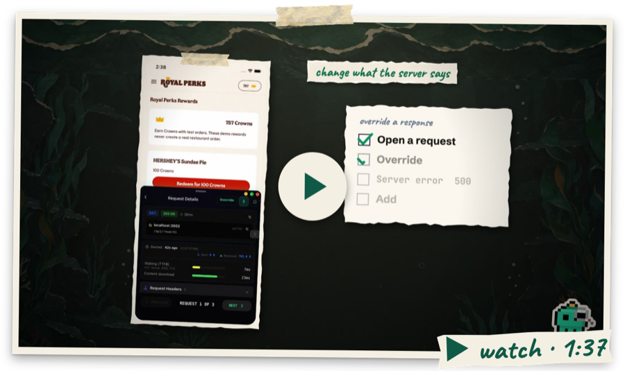

<div align="center">

# @buoy-gg/network

Inspect HTTP requests captured through your React Native app's global `fetch` and `XMLHttpRequest` hooks. Open a request to see its URL, status, headers, timing and captured body.

<a href="https://buoy.gg/buoy/latest/docs/tools/network"><b>Network guide</b></a> &nbsp;·&nbsp; <a href="https://buoy.gg">buoy.gg</a> &nbsp;·&nbsp; <a href="https://github.com/Buoy-gg/buoy">All tools</a>

[](https://www.npmjs.com/package/@buoy-gg/network) [](https://www.npmjs.com/package/@buoy-gg/network)

<a href="https://buoy.gg/buoy/latest/docs/tools/network"></a>

</div>

Buoy hides its own cloud settings calls from the list.

## Install

```bash
npm install @buoy-gg/core @buoy-gg/network
```

Render `<FloatingDevTools />` once in your app root and Network appears in the menu. Requests sent through a separate native transport are not captured.

Buoy keeps its own web calls out of this view. App calls still show when they use the same files.

## Sockets

Open **⋯ → Sockets** to see each WebSocket your app opens. You see each message, sent and got, newest first. A request shows its reply and how long it took. A row turns red when Buoy finds a problem. One example is a request with no reply. Another is a socket that drops again and again.

**Tricks** need Pro. They push a fake server message into your app. They can also drop, freeze or block the socket. Your app's real code handles each one. Buoy hides tokens and passwords. It does this before it keeps a message.

The MCP tools are `get_sockets` and `socket_action`. See the [Sockets guide](https://buoy.gg/buoy/latest/docs/tools/network#sockets).

## Slow links

Open **⋯ → Speed and link state** in Network.
The floating strip stays on while you test.
On Android, drag by the grip while you edit.
Tap Edit to show the controls, or Done to hide them.
Choose Slow 3G, Slow 4G, Fast 4G, or Offline.
The old Slow and Very slow choices just add waits.

Down caps pace bytes to the app in JS.
Up caps wait before send based on body bytes.
For gzip, down caps count unpacked body bytes.
Upload time is simulated. Neither cap paces the socket.
Caps apply to each call. They use global fetch and RN XHR.
Text, bytes and Blob uploads have known sizes.
FormData adds a wait for the parts we can size.
This includes text, bytes, Blob, and files with a `size`.
Unknown parts use just the start wait, then pass through.
The count skips headers and the bytes between fields.
Streams use just that wait. We do not read them first.
The list, detail, and MCP show each cap gap.

Native images, native SDKs and file transfers stay real. WebSocket stays real too, except in Offline.
Direct `expo/fetch` imports and saved fetch refs may bypass hooks.
Local file reads and Buoy's own web calls stay real.

The chip stays on when you close the tool.
No throttling clears both speed and app link state.
App reload clears them too. No throttling adds no byte wrapper or cap timer.
Normal capture still has its own cost. In a release build, these controls need a paid plan and the Buoy menu on screen.

### App link state

Load the hook before app imports in your dev entry:

```ts
import '@buoy-gg/network/netinfo';
// Or, if your app uses Expo Network:
import '@buoy-gg/network/expo-network';
```

Each hook needs its peer in the app already.
Core does not load these peers. It adds no native code.
Late setup shows a gap. Move the hook, then reload.
NetInfo 12 and Expo Network 56 are the tested peers.

Choose Real link, Offline, Wi-Fi, Cellular, or No internet.
Follow speed sets Offline with the Offline speed choice.
All other speed choices use the real link state.
No internet reports Wi-Fi with no internet access.
The radio and web calls do not change.
Restore sends the latest real state to the app.

NetInfo covers `fetch`, `refresh`, `addEventListener`, and `useNetInfo`.
Its isolated `useNetInfoInstance` hook is not a supported path.
Expo covers `getNetworkStateAsync`, `addNetworkStateListener`, and `useNetworkState`.
IP address and airplane-mode reads stay real.

### MCP and Desktop

Both views send changes to the selected device.
MCP uses `network_conditions` with `action: 'get'` or `'set'`.
Set accepts `profile`, `connection`, or both.
The reply shows rates, hook support, and what they affect.
If the link is lost, the view says so.

The [Network guide](https://buoy.gg/buoy/latest/docs/tools/network) covers setup, what it captures and its limits. New to Buoy? Start with the [Quick start](https://buoy.gg/buoy/latest/docs/quick-start).

---

<sub>Part of <a href="https://buoy.gg">Buoy</a>, developer tools that live inside your app. Proprietary software. © Buoy LLC. <a href="https://buoy.gg/terms">Terms</a></sub>
